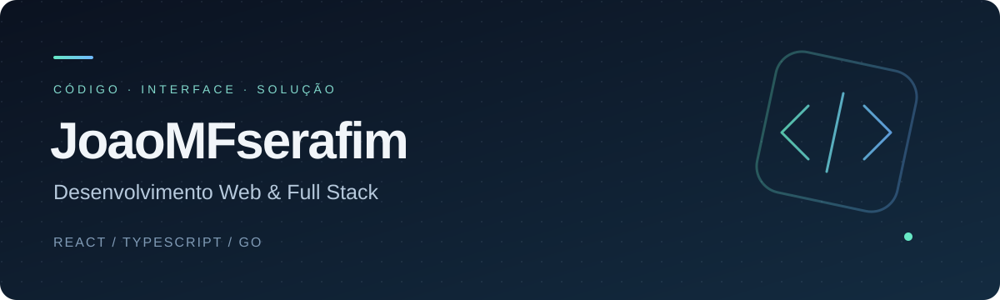

### Interfaces, aplicações e APIs.

React · TypeScript · JavaScript · Go · Firebase

[Projetos](#projetos-selecionados) · [Repositórios](https://github.com/JoaoMFserafim?tab=repositories)

---

## Olá, eu sou o João

Desenvolvo projetos web e exploro a conexão entre interfaces e serviços de back-end. Aqui reúno aplicações de estudo, ferramentas de cadastro e experiências de desenvolvimento com React, TypeScript e Go.

## Projetos selecionados

| Projeto | Proposta | Tecnologias |
| --- | --- | --- |
| [FlashMind](https://github.com/JoaoMFserafim/FlashMind) | Estudo com flashcards personalizados, sessões cronometradas e resultados. | React, TypeScript, Vite |
| [NBC · Cadastro de Atletas](https://github.com/JoaoMFserafim/NBCNovoBasqueteCarmo) | Cadastro e gestão de atletas com persistência no Firestore e exportação em PDF. | React, TypeScript, Firebase |
| [Task API](https://github.com/JoaoMFserafim/Go-api) | API REST para gerenciamento de tarefas, organizada em camadas. | Go, Gin, GORM, SQLite |
| [Emcomp](https://github.com/JoaoMFserafim/Site-emcomp) | Site institucional com apresentação de serviços e formulário de contato. | HTML, CSS, JavaScript |

## Tecnologias nos meus projetos

**Front-end** · React, TypeScript, JavaScript, HTML, CSS e Tailwind CSS  
**Back-end e dados** · Go, Gin, GORM, SQLite e Cloud Firestore  
**Ferramentas** · Git, GitHub, Vite e ESLint

---

Explore os projetos para conhecer o código, a estrutura e as instruções de execução.

